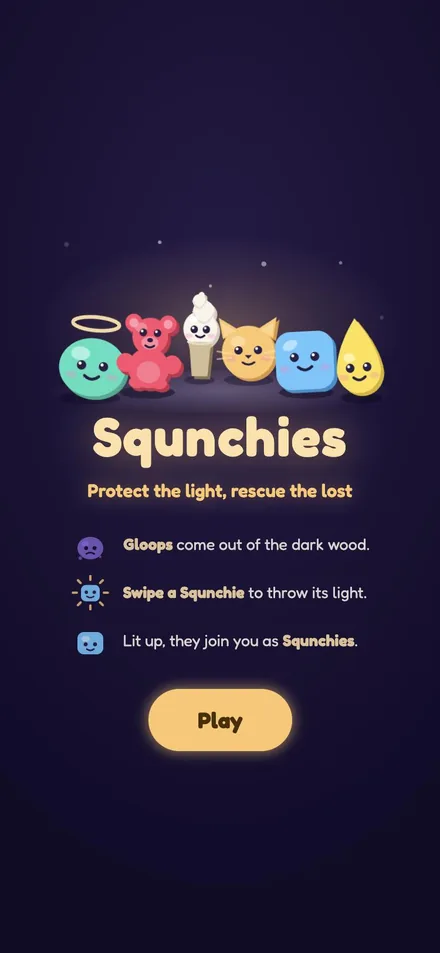
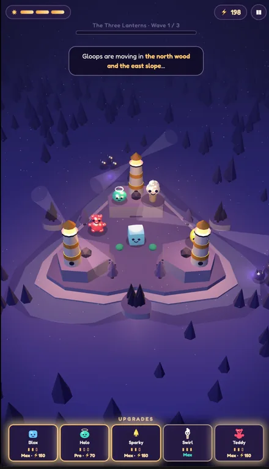
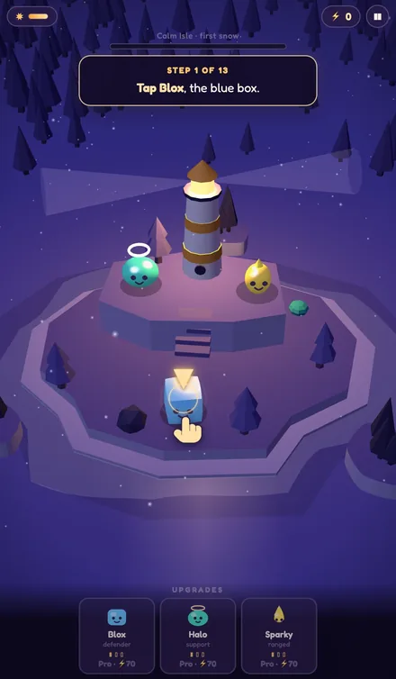
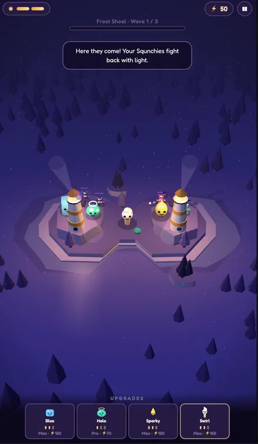
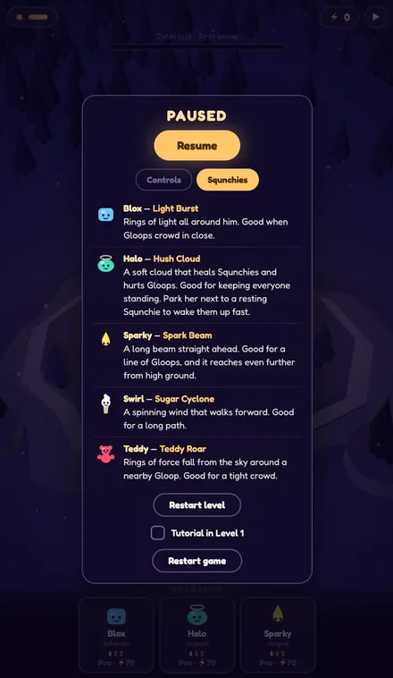
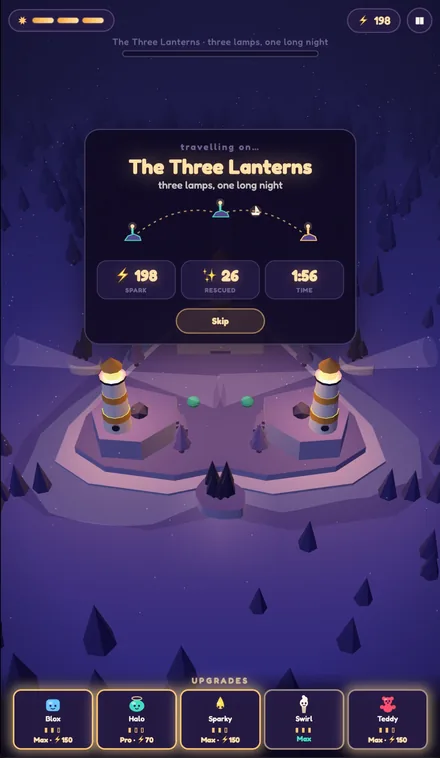
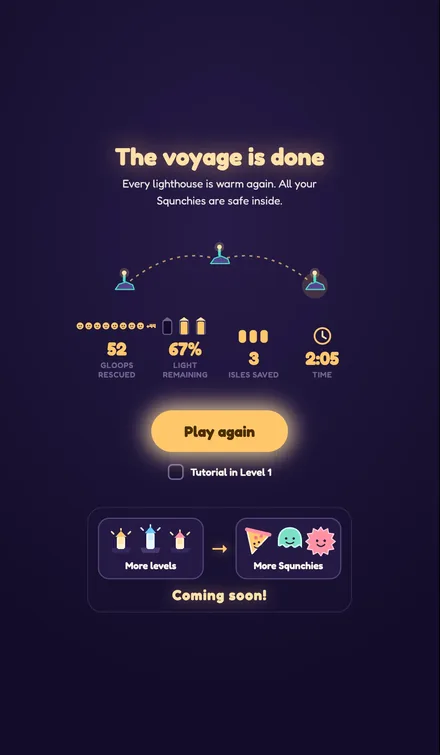

<div align="center">

# Squnchies

**Protect the light, rescue the lost**

*Built on an award-winning game design document from Meta's $10,000 Horizon Creator Competition — I present Squnchies: the playable thing that document described.*

 

### ▶︎ [**Play it in your browser**](https://amirmohideen.com/squnchies/)

*Best on a phone, held in portrait, one thumb.*

</div>

---

## The idea

Squishy toys are everywhere right now — the squeeze, the slow bounce back, the way a shelf of them feels like company. Squnchies is the cozy little world that belongs to them.

It's a night-time island defense. A lighthouse burns on a small isle. **Gloops** come wandering out of the dark wood and try to drown the lamp in ink. You hold them off with light.

The twist is what *squishing* means here. **Squeezing a Squnchie is the attack.** Swipe across one and it throws its light immediately. Press, hold to charge a ring — blue, then gold, then pulsing gold — and let go for something much bigger. The toy's defining gesture is the whole combat system.

And you don't kill anything. A Gloop filled with light stops being a Gloop. **Beat an isle's boss and it joins you**, playable, for the rest of the voyage. You end the night with a bigger family than you started with.

## How it plays

<div align="center">
 
</div>

| Do this | And |
|---|---|
| Tap a Squnchie | pick it |
| Tap a glowing ring | move them there |
| **Swipe across a Squnchie** | **throw its light now** |
| **Hold, then let go** | **a bigger attack** |
| Swipe the snow sideways | turn the island |
| Swipe up or down | zoom out and in |
| Pinch | zoom too |
| Tap a Squnchie in Upgrades | spend Spark ⚡ to grow it |

A 13-step tutorial walks you through all of it on the first isle, and it's a checkbox — **Tutorial in Level 1** — so anyone replaying can switch it off.

Light that you pour into a Gloop comes back as **Spark ⚡**. Spark does not buy *more* Squnchies — it buys a **bigger** one. Every squad is a single Squnchie growing **Base → Pro → Max** (70 ⚡, then 150 ⚡), swelling in size, reach and punch as it goes. Three friends who grow, not a crowd you accumulate.

Positioning is real: tactics run on a graph of zones, not a grid, and where a Squnchie stands decides what it can defend.

## The cast

<div align="center">

</div>

Three start with you:

| | Squnchie | Role | Charged attack |
|---|---|---|---|
| 🟦 | **Blox** | balanced defender | **Light Burst** — rings of light all around him, and it fans into 2 pulses at Pro, 3 at Max |
| 🟢 | **Halo** | support & purification | **Hush Cloud** — a soft cloud that heals Squnchies and hurts Gloops |
| 🟡 | **Sparky** | ranged light | **Spark Beam** — a long beam straight ahead, reaching further from high ground |

Three you have to earn:

| | Squnchie | Won from | Charged attack |
|---|---|---|---|
| 🍦 | **Swirl** | The Swirl | **Sugar Cyclone** — a spinning wind that walks forward |
| 🧸 | **Teddy** | Teddy | **Teddy Roar** — rings of force falling out of the sky |
| 🐱 | **Mewl** | The Mewl | **Ring Rush** |

## The voyage

<div align="center">
 
</div>

Three isles, three waves each — easy, medium, boss. Your squads and your Spark travel with you.

| | Isle | | Boss | You win |
|---|---|---|---|---|
| 1 | **Calm Isle** | *first snow* | The Swirl | Swirl |
| 2 | **Frost Shoal** | *two lamps in the snow* | Teddy | Teddy |
| 3 | **The Three Lanterns** | *three lamps, one long night* | The Mewl | Mewl |

A full run is about four minutes. The last isle is genuinely losable — that's the tension it's built to have.

## Run it yourself

```bash
git clone https://github.com/amirmohideen/squnchies.git
cd squnchies
node serve.js        # then open http://localhost:8642
```

Any static server works — `python3 -m http.server` is fine too. It **must** be served: the game uses ES modules, which browsers refuse to load over `file://`. Open the file directly and it'll tell you so rather than showing you a dead button.

## Under the hood

The whole game is **one `index.html`** — about 6,970 lines, roughly 640 of them comments, nothing minified. It's meant to be read.

What it does *not* contain is the interesting part:

- **Zero network calls.** No `fetch`, no `XMLHttpRequest`, no WebSocket, no CDN, no analytics. Clone it, pull the ethernet cable, it still plays.
- **Zero image files.** Every pixel is generated at runtime — Three.js geometry, canvas gradient textures, inline SVG for the 2D art. The characters on the title screen above are SVG drawn in the page.
- **Zero sound files.** All audio is synthesised live with the WebAudio API — each Squnchie's attack is an oscillator and a filter envelope, tuned by rendering it offline and measuring the result.
- **Two dependencies**, both vendored into the repo: [Three.js](https://threejs.org) r0.180.0 and the [Fredoka](https://fonts.google.com/specimen/Fredoka) typeface.

Everything is on relative paths, so it runs happily from a subdirectory. The 780-tree forest is a single `InstancedMesh` — two draw calls.

## What's next

More isles and more Squnchies to rescue. The voyage ends on a *coming soon*, not a full stop.

## Repo layout

```
index.html              the game — all of it
vendor/                 Three.js r0.180.0, vendored
assets/fonts/           Fredoka (SIL Open Font License)
docs/                   design documents
Squnchies-submission.zip the packaged competition build
serve.js                a dev server, port 8642
buildlog.md             a running log of every change and why
```

## Credits

Built by [Amir Mohideen](https://github.com/amirmohideen).

[Three.js](https://threejs.org) under the MIT license. [Fredoka](https://fonts.google.com/specimen/Fredoka) by the Fredoka Project Authors under the SIL Open Font License — see `assets/fonts/OFL.txt`.
